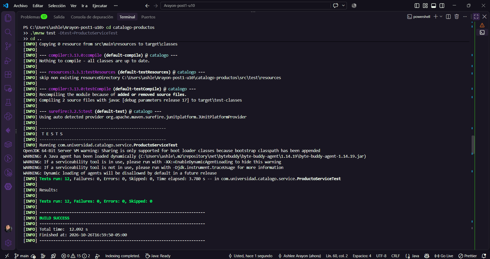
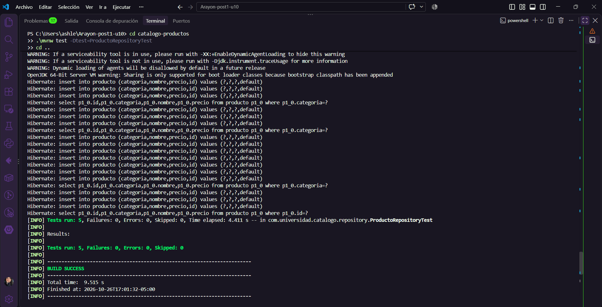
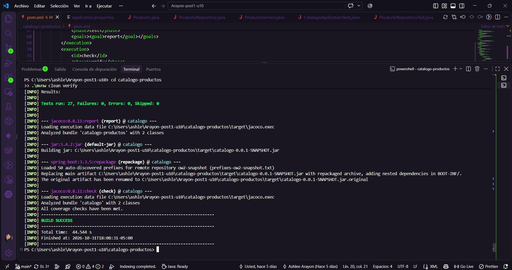
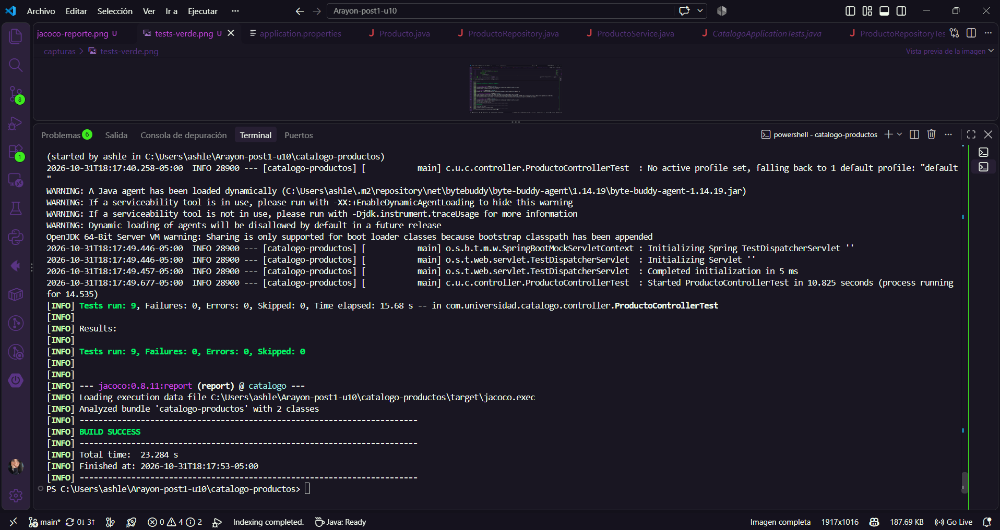
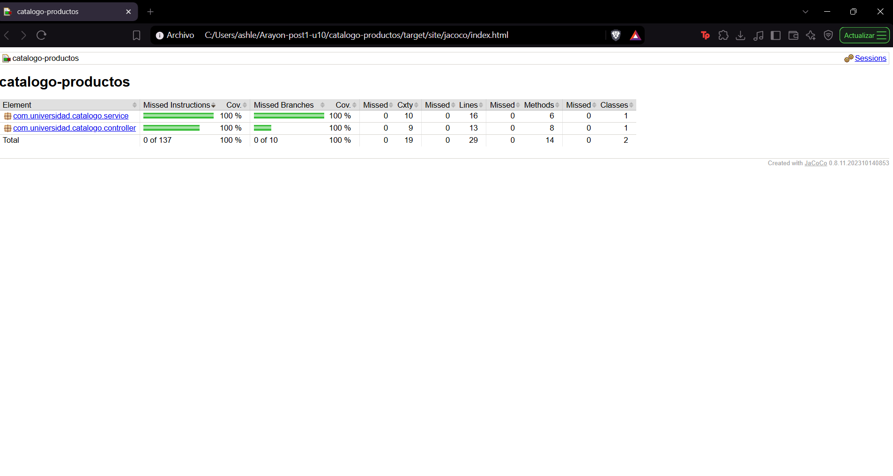
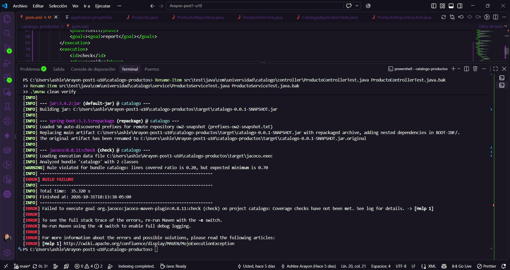
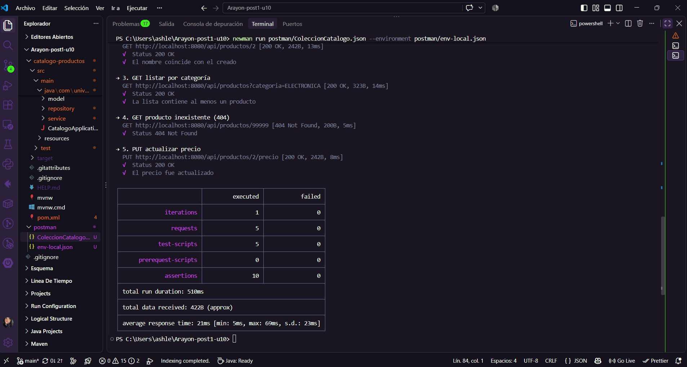
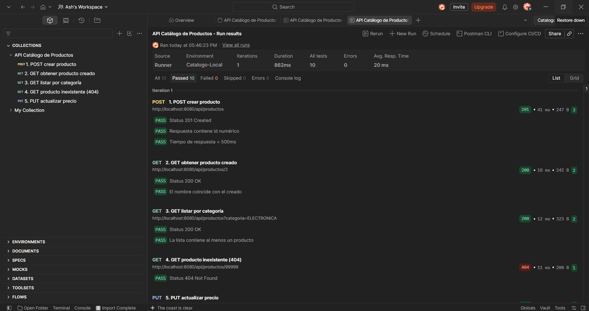

# Post-contenido — Unidad 10: Pruebas de Software en Aplicaciones Web

Laboratorio de Programación Web (Séptimo Semestre). Un único proyecto Maven Spring Boot
(`catalogo-productos/`, paquete `com.universidad.catalogo`) con una suite de pruebas
unitarias, de integración y de capa web sobre un catálogo de productos, una colección
Postman versionada y un umbral de cobertura verificado con JaCoCo.

## Parte 1: Pruebas unitarias con Mockito y de integración con @DataJpaTest

- **`ProductoServiceTest`** (`@ExtendWith(MockitoExtension.class)`, `@Mock`, `@InjectMocks`):
  prueba la lógica de negocio en aislamiento, sin base de datos. 12 tests: caso feliz y
  errores de cada método (precio negativo o cero, nombre vacío o nulo, producto inexistente).
- **`ProductoRepositoryTest`** (`@DataJpaTest` + `TestEntityManager`, H2 en memoria):
  prueba las consultas reales del repositorio. 5 tests.

## Parte 2: Pruebas web, Postman/Newman y JaCoCo

- **`ProductoControllerTest`** (`@WebMvcTest` + `MockMvc` + `@MockBean`): prueba la capa web
  sin levantar el contexto completo ni abrir un puerto. 9 tests (200, 201, 400, 404).
- **Colección Postman** (`postman/ColeccionCatalogo.json`, entorno `postman/env-local.json`):
  5 requests con test scripts contra la aplicación real en ejecución.
- **JaCoCo 0.8.11** con `check`: el build falla si la cobertura de líneas es menor al 70%.

Prueba deliberada del gate: con los tests de servicio y controlador desactivados, la
cobertura cae a 0.20 y `mvn verify` falla. Se restauraron y el build volvió a pasar.

## Orden en que se agregaron las pruebas
Primero unitarias (servicio), luego integración (repositorio), después la capa web
(controlador), Postman como prueba de extremo a extremo y, al final, JaCoCo.

## Decisiones de diseño
1. **H2 también en ejecución local:** el objetivo es escribir pruebas, no modelar persistencia contra un motor externo.
2. **`buscarPorId` lanza `EntityNotFoundException`** en vez de retornar `null`: contrato explícito, verificable con `assertThrows`.
3. **`@DataJpaTest` y no `@SpringBootTest`:** carga solo la capa de persistencia; suite más rápida y aislada.
4. **`@WebMvcTest` y no `@SpringBootTest` con `TestRestTemplate`:** evita duplicar cobertura con servicio y repositorio.
5. **Postman como `.json` versionado y no como JUnit:** prueba el contrato HTTP como caja negra contra un proceso real.
6. **JaCoCo al cierre de la Parte 2:** con las tres capas probadas, el 70% refleja el estado real y no una suite incompleta.
7. **Sin Selenium WebDriver:** el dominio es una API REST pura, sin vistas. Fabricar una vista solo para automatizarla contradiría la pirámide de pruebas; Postman cumple el rol de extremo a extremo sobre la superficie real. Con una vista Thymeleaf, Selenium con Page Object Model sí sería la herramienta correcta.

## Decisiones propias (ajustes al material base)
- **Spring Boot 3.3.5:** start.spring.io ofreció 4.x, cuya API difiere del código de la guía.
- **`spring-boot-starter-validation`** agregado: sin él `@NotBlank` no compila.
- **`@Valid` en el POST** y handler de `MethodArgumentNotValidException` (400): sin `@Valid`, `@NotBlank` nunca se activaba.
- **Endpoint `PUT /api/productos/{id}/precio`:** el enunciado probaba `actualizarPrecio` en el servicio pero no lo exponía.
- **Más tests que el mínimo:** 12 de servicio (el enunciado traía 4), 5 de repositorio y 9 de controlador.
- **Exclusiones de JaCoCo** (`*Application`, `model`) en la configuración general del plugin, para que apliquen al reporte y al `check` (el enunciado las dejaba solo en `check`).
- **Request PUT extra en Postman** para cubrir el endpoint nuevo.
- **`precio` como `double`:** se mantiene por coherencia con el enunciado; para dinero real convendría `BigDecimal`.
- **Umbral de tiempo en Postman:** la primera petición incluye la inicialización de Hibernate/Jackson y la latencia del Postman Agent, por eso se calentó la app antes del Runner.

## Cómo compilar y ejecutar
1. Clonar el repositorio.
2. `cd catalogo-productos` y `./mvnw spring-boot:run` (H2 en memoria, sin configuración extra).
3. Suite completa con cobertura: `./mvnw clean verify` (reporte en `target/site/jacoco/index.html`; falla si la cobertura es < 70%).
4. Con la app en ejecución: `newman run postman/ColeccionCatalogo.json --environment postman/env-local.json`